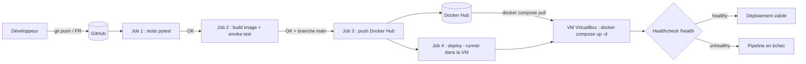

# TaskFlow — Guide complet CI/CD (Flask + Docker + GitHub Actions + VM VirtualBox)

## 0. Vue d'ensemble du projet

```
taskflow-devops/
├── app/main.py              # API Flask (stockage JSON)
├── tests/test_app.py        # 8 tests pytest
├── requirements*.txt
├── pytest.ini
├── Dockerfile               # image + HEALTHCHECK
├── docker-compose.yml       # déploiement sur la VM
├── .github/workflows/ci.yml # pipeline test → build → publish → deploy
└── GUIDE.md
```

Endpoints : `GET /health`, `GET/POST /tasks`, `GET/PUT/DELETE /tasks/<id>`.

---

## LIVRABLE 1 — Schéma du pipeline, workflow Git, choix des outils

### 1.1 Schéma du pipeline



Refais ce schéma proprement dans draw.io / Excalidraw (ou garde le Mermaid : GitHub l'affiche dans un `.md`). Exporte en PNG pour le rendu.

### 1.2 Workflow Git (GitHub Flow)

| Élément | Choix |
|---|---|
| Branche stable | `main` (protégée : PR obligatoire + CI verte) |
| Branches de travail | `feature/<sujet>`, `fix/<sujet>` |
| Cycle | branche → commits → push → Pull Request → CI → review → merge → déploiement auto |
| Commits | Format *Conventional Commits* : `feat:`, `fix:`, `test:`, `ci:`, `docs:` |
| Versions | Tags `v1.0.0` (release) |

Pourquoi GitHub Flow et pas GitFlow : une seule branche de production, adaptée au déploiement continu et à un petit projet.

Activer la protection : GitHub → Settings → Branches → *Add rule* sur `main` → cocher *Require a pull request* et *Require status checks (test, build)*.

### 1.3 Choix des outils (à justifier dans ton rendu)

| Besoin | Outil | Justification |
|---|---|---|
| Versionnement | Git + GitHub | Standard, intégré aux Actions |
| CI/CD | GitHub Actions | Pas de serveur à installer (contrairement à Jenkins), YAML dans le dépôt, gratuit |
| Tests | pytest | Simple, fixtures (`tmp_path`) pratiques |
| Conteneurisation | Docker | Environnement identique dev/CI/prod |
| Registre | Docker Hub | Gratuit, simple |
| Orchestration | docker-compose | Suffisant pour 1 service sur 1 VM |
| Serveur cible | VM Ubuntu (VirtualBox) | Demandé par le sujet |

---

## LIVRABLE 2 — Dockerfile + pipeline (tests + build)

### Étape 2.1 — Préparer le dépôt
```bash
git init
git add .
git commit -m "feat: api taskflow initiale"
git branch -M main
# créer un dépôt VIDE sur github.com (taskflow-devops), puis :
git remote add origin https://github.com/<TON_USER>/taskflow-devops.git
git push -u origin main
```

### Étape 2.2 — Tester en local
```bash
python -m venv .venv && source .venv/bin/activate   # Windows : .venv\Scripts\activate
pip install -r requirements-dev.txt
pytest -v                      # 8 tests doivent passer
python -m app.main             # API sur http://localhost:5000
curl -X POST localhost:5000/tasks -H "Content-Type: application/json" -d '{"title":"Test"}'
```

### Étape 2.3 — Construire et lancer l'image
```bash
docker build -t taskflow-api:local .
docker run -d --name tf -p 5000:5000 taskflow-api:local
docker ps                      # STATUS passe de "starting" à "healthy"
curl localhost:5000/health
docker rm -f tf
```

Points du Dockerfile à expliquer : image `slim`, copie de `requirements.txt` avant le code (cache des couches), utilisateur non-root, `gunicorn` (serveur de production), `HEALTHCHECK`.

### Étape 2.4 — Le pipeline CI
Le fichier `.github/workflows/ci.yml` contient déjà :
- job `test` : installe Python, lance `pytest` ;
- job `build` (`needs: test`) : construit l'image et fait un *smoke test* sur `/health`.

Déclenchement : à chaque push et chaque Pull Request vers `main`.

### Étape 2.5 — Vérifier
1. Push sur `main` → onglet **Actions** de GitHub.
2. Fais volontairement échouer un test (ex. change un code de retour attendu), pousse sur une branche `fix/test-casse`, ouvre une PR → capture écran de la CI **rouge**. Corrige → capture **verte**.

---

## LIVRABLE 3 — Docker Hub + déploiement automatique + healthcheck

### Étape 3.1 — Docker Hub
1. Crée un compte sur hub.docker.com.
2. Account Settings → Security → **New Access Token** (droits *Read & Write*). Copie-le.
3. (Optionnel) crée le dépôt `taskflow-api` (public).

### Étape 3.2 — Secrets GitHub
Dépôt → Settings → Secrets and variables → Actions → *New repository secret* :
- `DOCKERHUB_USERNAME` = ton identifiant Docker Hub
- `DOCKERHUB_TOKEN` = le token créé

### Étape 3.3 — Créer la VM VirtualBox
1. Télécharge **Ubuntu Server 22.04/24.04 LTS** (ISO) et installe VirtualBox.
2. Nouvelle VM : 2 Go RAM, 2 CPU, 20 Go disque. Installe Ubuntu Server (coche *Install OpenSSH server*).
3. Réseau : **Accès par pont (Bridged)** — la VM reçoit une IP de ton réseau (`ip a`).
   Alternative NAT : Paramètres → Réseau → Redirection de ports : hôte 5000 → invité 5000, hôte 2222 → invité 22.

### Étape 3.4 — Installer Docker dans la VM
```bash
sudo apt update && sudo apt install -y ca-certificates curl
curl -fsSL https://get.docker.com | sudo sh
sudo usermod -aG docker $USER && newgrp docker
docker --version && docker compose version
```

### Étape 3.5 — Installer le runner GitHub dans la VM
Pourquoi : GitHub ne peut pas joindre une VM locale derrière ta box. C'est donc la VM qui contacte GitHub (connexion sortante uniquement).

1. GitHub → dépôt → Settings → Actions → Runners → **New self-hosted runner** → Linux x64.
2. Copie-colle dans la VM les commandes affichées (téléchargement, `./config.sh --url ... --token ...`). Quand on demande les labels, ajoute : `vm`.
3. Installe-le en service :
```bash
sudo ./svc.sh install && sudo ./svc.sh start
sudo ./svc.sh status
```
Le runner doit apparaître **Idle** (vert) sur GitHub. Les labels `self-hosted, linux, vm` correspondent au job `deploy`.

### Étape 3.6 — Publication de l'image (job `publish`)
Après un merge sur `main`, le job se connecte à Docker Hub et pousse deux tags : `latest` et le SHA du commit (traçabilité / rollback).
Vérifie sur hub.docker.com que l'image apparaît.

### Étape 3.7 — Déploiement automatique (job `deploy`)
Le job s'exécute sur la VM : `docker compose pull` puis `docker compose up -d`, puis attend que le conteneur soit `healthy`.

### Étape 3.8 — Healthcheck
Deux niveaux déjà configurés :
- Dockerfile : `HEALTHCHECK` appelle `/health` toutes les 30 s ;
- docker-compose.yml : même check + `restart: unless-stopped`.

Vérifier dans la VM :
```bash
docker ps                                   # (healthy)
docker inspect --format '{{json .State.Health}}' taskflow-api
curl http://localhost:5000/health
```
Depuis ton PC : `http://<IP_VM>:5000/health` (ou `localhost:5000` en NAT avec redirection).

### Étape 3.9 — Test de bout en bout
1. Modifie l'API (ex. ajoute un champ dans `/health`), commit sur `feature/...`, PR, merge.
2. Observe les 4 jobs passer au vert, puis `curl http://<IP_VM>:5000/health` renvoie la nouvelle version.
3. Teste la résilience : `docker kill taskflow-api` → il redémarre (restart policy).
4. Teste la persistance : crée une tâche, redéploie, vérifie qu'elle existe encore (volume `taskflow-data`).

---

## Checklist du rendu

- [ ] Dépôt GitHub (lien) avec historique de commits et au moins une PR
- [ ] Schéma du pipeline (PNG) + explication du workflow Git + tableau des outils
- [ ] Dockerfile, `ci.yml`, `docker-compose.yml`
- [ ] Capture : CI rouge puis verte
- [ ] Capture : image sur Docker Hub
- [ ] Capture : runner Idle + job deploy vert
- [ ] Capture : `docker ps` avec `(healthy)` dans la VM et `curl /health`
- [ ] Courte conclusion : difficultés rencontrées, améliorations possibles (rollback, tests d'intégration, scan de sécurité Trivy, notifications)

## Dépannage rapide

| Problème | Cause probable | Solution |
|---|---|---|
| `ModuleNotFoundError: app` | pytest ne trouve pas le package | `pytest.ini` avec `pythonpath = .` (déjà fourni) |
| `denied: requested access` au push | mauvais username/token | Vérifier les secrets, token en Read & Write |
| Job `deploy` reste « Queued » | runner éteint ou labels différents | `sudo ./svc.sh status` ; vérifier le label `vm` |
| `permission denied` docker (runner) | utilisateur pas dans le groupe docker | `sudo usermod -aG docker $USER` puis redémarrer le service runner |
| Pas d'accès à `<IP_VM>:5000` | réseau NAT sans redirection | Mode Bridged ou redirection de port ; `sudo ufw allow 5000` |
| Conteneur `unhealthy` | app plantée | `docker logs taskflow-api` |
